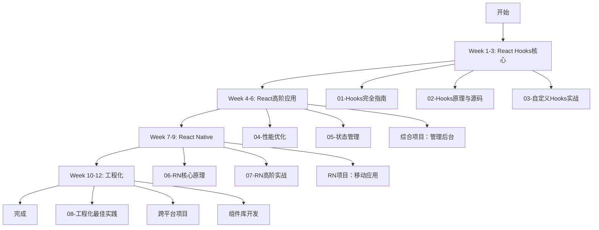

# React Hooks & React Native 深度学习教程

> 适合10年前端开发者的系统学习计划 - 从原理到实战

## 🎯 教程简介

这是一套专为**有经验的前端开发者**设计的React Hooks和React Native深度学习教程。不同于入门教程，本系列深入探讨**底层原理、源码实现、高阶用法和工程实践**。

### 适合人群

- ✅ 有5-10年前端开发经验
- ✅ 熟悉JavaScript/TypeScript
- ✅ 使用过React/Vue等框架
- ✅ 想深入理解React Hooks原理
- ✅ 需要开发React Native应用
- ✅ 追求代码质量和工程化

### 学习收获

完成本教程后，你将能够：

1. **精通React Hooks**
   - 理解Fiber架构和Hooks底层实现
   - 设计复杂的自定义Hooks
   - 解决各种Hooks问题和性能优化

2. **React Native专家**
   - 理解RN架构（Bridge、JSI、Fabric、TurboModules）
   - 开发iOS/Android原生模块
   - 实现复杂动画和手势交互

3. **工程化能力**
   - TypeScript高级用法
   - 组件库设计
   - 测试策略和CI/CD
   - Monorepo架构

4. **实战项目**
   - 管理后台系统
   - 移动应用
   - 跨平台项目
   - 可复用组件库

---

## 📚 教程目录

### 核心文档（已完成）

#### 📖 [00-学习路线图与进度跟踪.md](./00-学习路线图与进度跟踪.md)
**从这里开始！** 完整的12周学习计划、进度跟踪表、项目建议

- 📅 详细的12周学习计划
- ✅ 进度跟踪表格
- 🎯 9个实战项目建议
- 📖 学习资源推荐
- 💡 学习方法和建议

#### 📘 [01-React-Hooks完全指南.md](./01-React-Hooks完全指南.md)
**基础必读** | 48KB | Week 1

所有官方Hooks的深入讲解和实战应用

- 🎓 7章内容，涵盖所有Hooks
- 💻 30+完整代码示例
- 🔄 从Class组件迁移指南
- 🆚 Hooks vs Vue 3 Composition API对比
- ⚠️ 常见问题与反模式

**核心内容**
- useState、useEffect、useContext深度解析
- useReducer复杂状态管理
- useRef、useMemo、useCallback性能优化
- useImperativeHandle、useLayoutEffect高级用法
- Hooks规则和最佳实践

#### 📕 [02-React-Hooks原理与源码解析.md](./02-React-Hooks原理与源码解析.md)
**原理深入** | 37KB | Week 2

深入React底层，理解Hooks的实现机制

- 🏗️ Fiber架构详解
- 🔗 Hooks链表数据结构
- 📝 useState/useEffect/useReducer源码分析
- ⚡ Lane优先级模型
- 🔄 调度和更新机制
- 🎯 为什么要遵守Hooks规则

**核心内容**
- Fiber树和双缓存机制
- Hooks链表如何工作
- dispatchSetState完整流程
- Effect执行时机和原理
- 批量更新机制
- 并发渲染原理

#### 📗 [03-自定义Hooks开发实战.md](./03-自定义Hooks开发实战.md)
**实战必备** | 24KB | Week 3

20+实用自定义Hooks，掌握设计模式

- 🎨 Hooks设计原则
- 📦 20+完整实现的自定义Hooks
- 🧪 Hooks测试方法
- 📱 React Native专用Hooks

**包含的Hooks**
- **状态管理**: useToggle, useLocalStorage, useSetState, useList
- **副作用**: useDebounce, useThrottle, useInterval, useEventListener
- **数据获取**: useFetch, useAsync
- **DOM/BOM**: useWindowSize, useClickOutside, useIntersectionObserver
- **性能优化**: usePrevious, useWhyDidYouUpdate
- **工具类**: useMediaQuery, useCopyToClipboard
- **RN专用**: useKeyboard, useAppState

### 高级文档（待补充）

#### 📙 04-React性能优化深度指南.md
**Week 4** | 性能提升的完整方案

- React渲染机制深入
- React.memo、useMemo、useCallback原理和使用
- 虚拟列表实现
- Code Splitting和懒加载
- 性能分析工具（Profiler、React DevTools）
- 实战：优化大列表性能

#### 📓 05-React状态管理方案对比.md
**Week 5** | 全面对比主流状态管理方案

- Context + useReducer模式
- Redux Toolkit完整指南
- Zustand、Jotai、Recoil对比
- TanStack Query (React Query)
- 状态管理选型决策树
- 实战：购物车应用

#### 📔 06-React-Native核心原理.md
**Week 7-8** | RN底层架构深度解析

- **架构演进**
  - 旧架构（Bridge）原理
  - 新架构（Fabric + TurboModules + JSI）
  - 架构对比和迁移

- **原生模块开发**
  - iOS原生模块（Objective-C/Swift）
  - Android原生模块（Java/Kotlin）
  - 原生UI组件开发
  - 实战：相机、蓝牙模块

- **性能优化**
  - Bundle优化
  - 启动速度优化
  - 渲染性能优化
  - 内存优化

#### 📒 07-React-Native高阶实战.md
**Week 9** | RN高级功能实现

- **导航系统**
  - React Navigation深度使用
  - 自定义转场动画
  - 深度链接

- **动画系统**
  - Reanimated 2/3完整教程
  - 共享元素转场
  - 复杂动画实现

- **手势处理**
  - Gesture Handler
  - 自定义手势识别
  - 手势与动画结合

- **高级功能**
  - 离线存储和同步
  - 推送通知
  - 热更新（CodePush/自建）
  - 原生能力集成

#### 📄 08-React工程化与最佳实践.md
**Week 10-12** | 建立完整的工程化体系

- **TypeScript**
  - 高级类型
  - 泛型组件设计
  - 类型体操

- **组件设计模式**
  - HOC（高阶组件）
  - Render Props
  - Compound Components
  - Headless Components

- **测试体系**
  - Jest单元测试
  - React Testing Library
  - Cypress E2E测试
  - 测试策略和覆盖率

- **构建优化**
  - Vite配置
  - Webpack优化
  - Metro配置（RN）
  - Bundle分析

- **CI/CD**
  - GitHub Actions
  - 自动化测试
  - 自动化部署
  - 版本管理

- **Monorepo**
  - pnpm + Turborepo
  - 代码共享策略
  - 依赖管理

---

## 🗓️ 学习计划

### 推荐学习路径



### 时间安排

| 阶段 | 周数 | 内容 | 成果 |
|------|------|------|------|
| **阶段一** | Week 1-3 | React Hooks核心 | Todo List、Hooks库 |
| **阶段二** | Week 4-6 | React高阶应用 | 管理后台系统 |
| **阶段三** | Week 7-9 | React Native | 移动应用 |
| **阶段四** | Week 10-12 | 工程化实践 | 跨平台项目 |

**总计**: 12周（每周8-10小时）

---

## 🚀 快速开始

### 1. 阅读学习路线图

👉 **从这里开始**：[00-学习路线图与进度跟踪.md](./00-学习路线图与进度跟踪.md)

了解完整的学习计划、进度跟踪方法和项目建议。

### 2. Week 1开始学习

📖 **第一周学习**：[01-React-Hooks完全指南.md](./01-React-Hooks完全指南.md)

按顺序学习所有Hooks，边学边练。

### 3. 动手实践

💻 **实战项目**：Todo List应用

将所学的Hooks知识应用到实际项目中。

### 4. 深入原理

🔬 **第二周学习**：[02-React-Hooks原理与源码解析.md](./02-React-Hooks原理与源码解析.md)

理解Hooks的底层实现，知其然知其所以然。

### 5. 掌握实战

🛠️ **第三周学习**：[03-自定义Hooks开发实战.md](./03-自定义Hooks开发实战.md)

实现20+自定义Hooks，掌握设计模式。

---

## 📖 如何使用本教程

### 推荐学习方式

1. **顺序学习**
   ```
   00-学习路线图 → 01-Hooks完全指南 → 02-Hooks原理 → 03-自定义Hooks → ...
   ```

2. **理论+实践**
   - 看完一章立即写代码验证
   - 每个示例都要亲自实现
   - 完成章节末的练习题

3. **记录笔记**
   - 使用Markdown记录学习笔记
   - 画图辅助理解（Fiber树、数据流等）
   - 总结知识点和疑问

4. **项目驱动**
   - 边学边做项目
   - 将知识点应用到实际场景
   - 遇到问题查文档解决

5. **源码阅读**
   - 带着问题阅读源码
   - 从简单的Hook开始
   - 配合调试工具理解执行流程

### 学习建议

#### ✅ 推荐做法

- 每天固定学习时间（1-2小时）
- 动手写代码验证概念
- 做笔记和思维导图
- 参与社区讨论
- 分享学习心得

#### ❌ 避免陷阱

- 只看不练
- 追求速度忽视质量
- 遇到困难就放弃
- 不理解原理就开始用
- 过度优化

---

## 🎯 实战项目

### 初级项目 (Week 1-3)

1. **Todo List** - Hooks基础
2. **天气应用** - 数据获取
3. **计算器** - useReducer

### 中级项目 (Week 4-6)

4. **管理后台** - 完整的Web应用
5. **电商应用** - 购物车和订单
6. **博客系统** - Markdown编辑

### 高级项目 (Week 7-12)

7. **社交应用(RN)** - 动态、聊天、推送
8. **音乐播放器(RN)** - 音频、动画
9. **跨平台记账** - Web + RN共享代码

---

## 📚 学习资源

### 官方文档
- [React官方文档](https://react.dev/)
- [React Native官方文档](https://reactnative.dev/)

### 源码阅读
- [React源码](https://github.com/facebook/react)
- [React Native源码](https://github.com/facebook/react-native)

### 工具库
- [ahooks](https://ahooks.js.org/) - 实用Hooks集合
- [React Query](https://tanstack.com/query) - 数据获取
- [Zustand](https://zustand-demo.pmnd.rs/) - 状态管理
- [Reanimated](https://docs.swmansion.com/react-native-reanimated/) - RN动画

---

## 💡 特色亮点

### 🔬 深入原理
- 不只教你怎么用，更要让你知道为什么
- 大量源码分析和原理讲解
- Fiber架构、Hooks链表、调度机制深度剖析

### 💻 实战导向
- 30+完整代码示例
- 20+自定义Hooks实现
- 9个实战项目建议
- 覆盖Web和移动端

### 🎨 对比分析
- Hooks vs Class组件
- Hooks vs Vue 3 Composition API
- 多种状态管理方案对比
- RN旧架构 vs 新架构

### 🛠️ 工程化
- TypeScript最佳实践
- 测试策略
- CI/CD流程
- Monorepo架构

### 📱 React Native深度
- iOS/Android原生模块开发
- 新架构（Fabric + TurboModules + JSI）
- 复杂动画和手势
- 性能优化实战

---

## 📊 学习进度

### 文档完成度

| 文档 | 状态 | 大小 | 章节 |
|------|------|------|------|
| 00-学习路线图 | ✅ 已完成 | 20KB | 综合 |
| 01-Hooks完全指南 | ✅ 已完成 | 48KB | 7章 |
| 02-Hooks原理与源码 | ✅ 已完成 | 37KB | 8章 |
| 03-自定义Hooks实战 | ✅ 已完成 | 24KB | 9节 |
| 04-React性能优化 | 📝 待补充 | - | - |
| 05-React状态管理 | 📝 待补充 | - | - |
| 06-RN核心原理 | 📝 待补充 | - | - |
| 07-RN高阶实战 | 📝 待补充 | - | - |
| 08-React工程化 | 📝 待补充 | - | - |

**当前进度**: 4/9 (44%)

---

## 🤝 贡献指南

### 反馈问题

如果你在学习过程中发现：
- 文档错误或不清楚的地方
- 代码示例有问题
- 需要补充的内容

欢迎提Issue或Pull Request！

### 分享经验

完成学习后，欢迎分享：
- 学习笔记和心得
- 实战项目
- 补充知识点

---

## 📝 更新日志

### v1.0.0 (2025-10-24)
- ✅ 完成学习路线图
- ✅ 完成Hooks完全指南
- ✅ 完成Hooks原理与源码解析
- ✅ 完成自定义Hooks开发实战
- 📝 待补充后续5个文档

---

## 📞 联系方式

### 问题讨论
- 使用GitHub Issues讨论问题
- 参与React中文社区
- Stack Overflow提问

### 学习打卡
建议创建自己的学习仓库：
```bash
my-react-learning/
├── week-01/
│   ├── notes.md
│   ├── code/
│   └── projects/
├── week-02/
...
```

---

## 📄 版权声明

本教程仅供学习交流使用，转载请注明出处。

代码示例基于React 18和React Native最新版本。

---

## 🎓 结语

学习React Hooks和React Native不是一蹴而就的过程，需要**理论学习、实践应用、源码阅读、项目锻炼**相结合。

希望这套教程能帮助你：
- 🎯 系统掌握React Hooks
- 🚀 深入理解底层原理
- 💪 提升工程实践能力
- 📱 熟练开发React Native应用

**现在就开始吧！** 👉 [00-学习路线图与进度跟踪.md](./00-学习路线图与进度跟踪.md)

**祝学习顺利！加油！** 💪

---

*Created by Claude Code | Last Updated: 2025-10-24*
